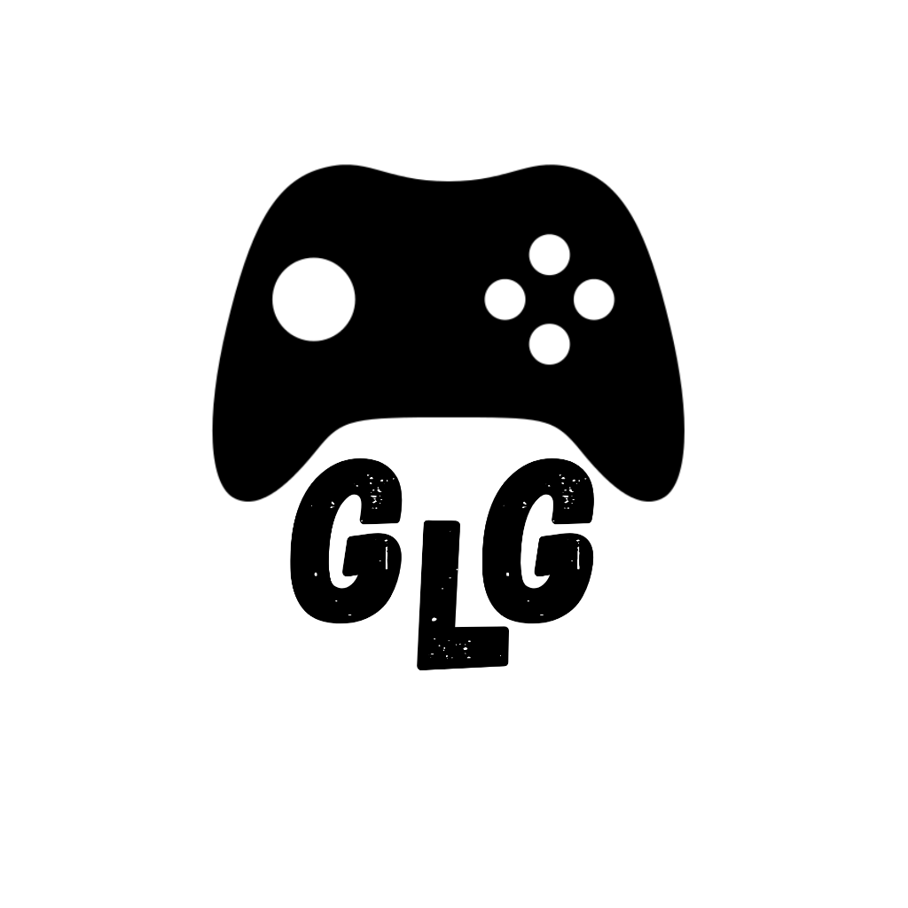

<p align="center">
  
</p>

<h1 align="center">GGL - Generic Game Launcher</h1>

<p align="center">
  <strong>A refined, tactile PC App & Game Hub for Windows</strong>
</p>

<p align="center">
  
  
  
  
  
  
</p>

---

## 📖 Overview

**GGL (Generic Game Launcher)** is a modern, unified desktop application for Windows that aggregates your entire PC gaming and software library across **Steam**, **Epic Games**, **GOG**, **BlueStacks**, and the **Windows Start Menu & Registry**.

Designed from the ground up to replace aggressive, neon gamer-centric launchers with the clean, tactile visual standards of **Apple macOS**, **Spotify**, and **Notion**.

---

## ✨ Design Philosophy & Materiality

- **Tactile Minimalism:** Discards neon glitches and harsh angular cuts in favor of subtle frosted glassmorphism (`backdrop-blur-md`), 1px hairline border strokes, and smooth spring physics.
- **5 Consumer-Grade Theme Palettes:**
  1. **Studio Zinc:** Apple / Linear style with balanced neutral grays and crisp accents.
  2. **Atmospheric Dark:** Spotify style with graphite surfaces and Spotify green accents.
  3. **Warm Paper:** Notion style with warm parchment tones and amber highlights.
  4. **Fluid Indigo:** Samsung One UI style with deep indigo hues and fluid highlights.
  5. **Frosted Glacier:** macOS Sequoia style with frosted slate surfaces and sky accents.
- **Color Mode Flexibility:** Instant switching between **Dark Mode**, **Light Mode**, and **System Auto Mode** via dynamic CSS variable tokens without page reloads.
- **Dedicated Settings Center:** Centralized appearance, view preferences, library scanner triggers, and display options accessible from the top bar or sidebar footer.

---

## 🚀 Key Features

### 1. Smart "Add Program" Engine (Spotlight / Raycast Modal)
Press **`Ctrl + K`** anywhere in the app to open the instant Spotlight search modal:
- **System Program Indexer:** Instantly searches software installed on your PC by reading Windows Start Menu shortcuts (`%ProgramData%` and `%APPDATA%`) and Windows Registry Uninstall records. Add any desktop app or game in one click.
- **BlueStacks & Emulator Detection:** Specially indexes emulator games (e.g. Pokémon TCG Pocket, Mobile Legends) with custom launch parameters.
- **Custom Executable Picker:** Browse `.exe` or `.bat` binaries directly, assign category (*Game* or *Application*), configure custom launch arguments, and select custom cover artwork.

### 2. Universal 5-Tier Artwork Pipeline
No broken cards or blank placeholder boxes:
1. **Tier 1 (Steam CDN):** High-res vertical box art (600x900) automatically queried for Steam titles.
2. **Tier 2 (Official Box Art Database):** Accurate cover art matching (e.g. FIFA 16, Minecraft, Assetto Corsa) preventing misidentification.
3. **Tier 3 (Native Executable Icon Extraction):** High-resolution icon resources extracted directly from local binaries via native utilities and cached locally.
4. **Tier 4 (Local Directory Artwork Discovery):** Automatically scans game install directories for bundled cover files (`cover.jpg`, `boxart.png`, `poster.webp`).
5. **Tier 5 (Graceful Monogram Art):** Minimalist Spotify/Notion-style slate card with soft gradient and centered monogram.

### 3. Automatic Game Scanners
- **Steam:** Reads `HKCU\Software\Valve\Steam\SteamPath`, parses `libraryfolders.vdf` across all storage drives, and reads `appmanifest_<appid>.acf`. Launches via `steam://run/<appid>`.
- **Epic Games:** Scans `%ProgramData%\Epic\EpicGamesLauncher\Data\Manifests\*.item`. Launches via `com.epicgames.launcher://apps/<AppName>?action=launch&silent=true`.
- **GOG & Custom:** Scans Windows uninstall registry keys and common install directories (`C:\Games`, `D:\Games`).

### 4. Interactive Execution & Telemetry
- Dedicated **"Play"** button on each card with micro-interaction hover states.
- Live **Process Dispatcher HUD** tracks launch initialization, protocol resolution, and detached process spawning in real time.
- **Telemetry & Insights Modal:** Tracks total launches, playtime statistics, most-launched titles, and platform breakdown.

### 5. Multi-Layout Presentation
- **2:3 Poster Grid:** Full vertical cover presentation with interactive play buttons and context menus.
- **1:1 Square Grid:** Balanced square view ideal for desktop applications and tools.
- **Clean List View (Notion Table):** High-density layout displaying title, platform, category badge, launch count, last launched timestamp, and quick actions.

---

## 🛠 Tech Stack

- **Shell:** Electron 44 (Node.js runtime + desktop process bridge)
- **Frontend:** React 19 + TypeScript + Vite 8
- **Styling:** Tailwind CSS v4 + Framer Motion
- **Icons:** `lucide-react`
- **State Management:** Zustand with persistent JSON database (`fluent-hub-db.json`)
- **Testing:** Vitest

---

## 💻 Getting Started

### Prerequisites
- Windows 10 or 11 (64-bit)
- Node.js 18+ and npm

### Installation & Development
```bash
# Clone the repository
git clone https://github.com/anjishnughosh72501/GGL---Generic-Game-Launcher.git

# Enter the project directory
cd "GGL---Generic-Game-Launcher"

# Install dependencies
npm install

# Start live development (Vite frontend + Electron with hot reload)
npm run dev
```

### Production Build
```bash
# Compile TypeScript, package Vite assets, and build Electron main process
npm run build

# Start the built desktop application
npm start
```

---

## 📦 Releases & Downloads

Pre-built standalone Windows releases are available in the [GitHub Releases](https://github.com/anjishnughosh72501/GGL---Generic-Game-Launcher/releases) section:
- **`GGL-Setup-1.0.0.exe`**: Windows 64-bit Installer with desktop and start menu shortcuts.
- **`GGL-Portable-1.0.0.exe`**: Standalone portable Windows executable (no installation required).

> [!NOTE]
> GGL is a native Windows desktop application designed to interact with the Windows Registry, file system, and native PC games. Mobile package formats (such as Android `.apk`) are not applicable.

---

## 📄 License

This project is licensed under the [MIT License](LICENSE).
